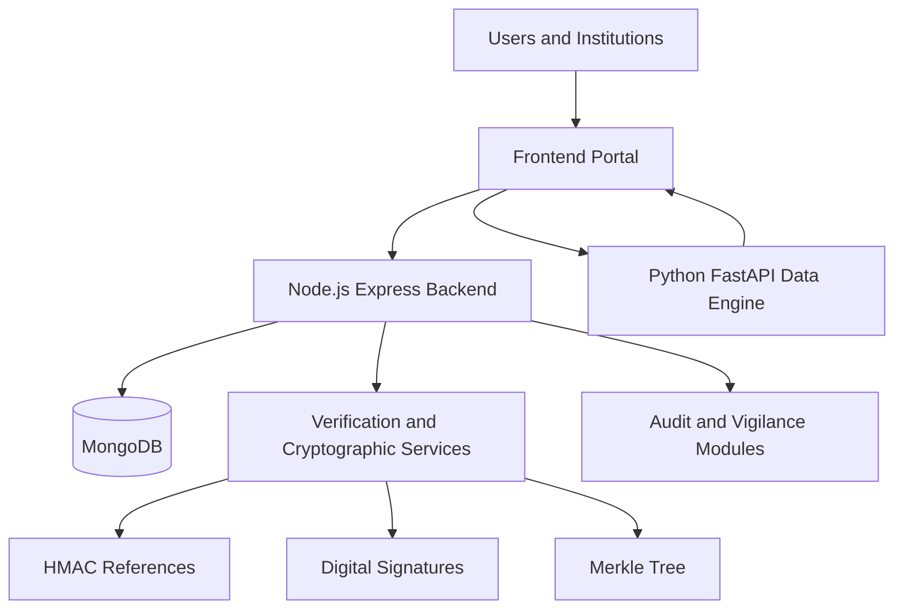

# AICTE-PRAMAAN

### Student Record Management, Verification & Audit Portal

AICTE-PRAMAAN is a web-based prototype designed to demonstrate student admission record management, institutional verification, cryptographic record integrity and audit-oriented monitoring.

The platform combines a browser-based portal, a Node.js backend, MongoDB persistence and a separate Python-based synthetic data generation service.

> **Project status:** Academic and demonstration prototype. This project is not an official AICTE government service. Do not use real student personal information with the current demonstration authentication system.

---

## Live Demo

| Component | URL |
|---|---|
| Frontend Portal | https://aicte-pramaan-frontend.onrender.com |
| Backend API | https://aicte-pramaan-api.onrender.com |
| Backend Health | https://aicte-pramaan-api.onrender.com/health |
| Data Engine | https://aicte-pramaan-data-engine.onrender.com |
| Data Engine API Documentation | https://aicte-pramaan-data-engine.onrender.com/openapi.json |

---

## Project Overview

AICTE-PRAMAAN demonstrates a centralized workflow for managing and verifying student admission records.

The system is designed to support institutional record submission, verification workflows, QR-based validation, cryptographic integrity checks and administrative audit activities.

It uses a modular architecture with separate frontend, backend and data-generation components.

## Key Features

### 1. Dashboard
- Centralized portal dashboard.
- Role-oriented navigation.
- Activity and record overview.
- Administrative workflows.

### 2. Student Record Management
- Student admission record ingestion.
- Institution-oriented record workflows.
- Duplicate reference detection.
- Consent-related record attributes.

### 3. Verification & Certificates
- QR-based verification workflows.
- HMAC-based record reference mechanisms.
- Digital signature verification support.
- Merkle tree integrity verification.

### 4. Audit Trail
- Audit event recording.
- Hash-linked audit history.
- Audit chain integrity verification.

### 5. Vigilance Center
- Demonstration anomaly-analysis workflows.
- Potential duplicate detection.
- Administrative review capabilities.

### 6. Dispute Resolution
- Administrative dispute and review interface.
- Record-oriented review workflows.

### 7. Synthetic Data Engine
- Synthetic student record generation.
- Python-based data generation service.
- SHA-256 hashing and Merkle root generation.

---

## Technology Stack

| Component | Technologies |
|---|---|
| Frontend | HTML5, CSS3, JavaScript |
| Backend | Node.js, Express.js |
| Database | MongoDB, Mongoose |
| Authentication | JWT, bcryptjs |
| Cryptography | SHA-256, HMAC, Ed25519 |
| Integrity Verification | Merkle Trees |
| Data Engine | Python, FastAPI, Uvicorn, Faker |
| Infrastructure | Docker, Docker Compose |
| Deployment | Render |

---

## System Architecture



### Architecture Components

- **Frontend:** User interface, dashboard and application interactions.
- **Backend:** API endpoints, authentication, application logic and record workflows.
- **MongoDB:** Application data persistence.
- **Cryptographic Services:** Record integrity and verification mechanisms.
- **Data Engine:** Synthetic record generation for demonstration and testing.

---

## Project Structure

```text
AICTE-PRAMAAN/
│
├── backend/
│   ├── config/
│   ├── middleware/
│   ├── models/
│   ├── routes/
│   ├── utils/
│   ├── Dockerfile
│   ├── package.json
│   └── server.js
│
├── frontend/
│   ├── assets/
│   ├── app.js
│   ├── index.html
│   └── style.css
│
├── data-engine/
│   ├── Dockerfile
│   ├── generator.py
│   └── requirements.txt
│
├── docker-compose.yml
├── package-lock.json
└── README.md
```

---

## Getting Started

### Prerequisites

Install the following:

- Git
- Node.js and npm
- MongoDB
- Python 3.11 or later
- pip
- Docker (optional)

### 1. Clone the Repository

```bash
git clone https://github.com/aicte-pramaan/aicte-pramaan.git

cd aicte-pramaan
```

### 2. Set Up the Backend

```bash
cd backend
npm install
```

Create a `.env` file in the backend directory and configure the environment variables required by the backend source code.

Never upload your real `.env` file or secret keys to GitHub.

Start the backend using the start command defined in `backend/package.json`.

### 3. Set Up the Data Engine

Open another terminal:

```bash
cd data-engine

python3 -m venv .venv

source .venv/bin/activate

pip install -r requirements.txt
```

Start the service:

```bash
python generator.py
```

The Data Engine uses port `8000` by default.

Its API schema is available at:

```text
http://localhost:8000/openapi.json
```

### 4. Configure the Frontend

The frontend files are located in the `frontend/` directory.

For local integration, configure the backend and Data Engine base URLs in `frontend/app.js` to point to your local services.

The current deployed version uses Render service URLs by default.

---

## Health Check Endpoints

| Service | Endpoint |
|---|---|
| Backend | `/health` |
| Backend wake-up | `/api/data` |
| Data Engine | `/health` |
| Data Engine API schema | `/openapi.json` |

---

## Security Considerations

The project demonstrates security-oriented mechanisms including:

- JWT-based authentication middleware.
- Role-based authorization.
- HMAC-based record references.
- Cryptographic hashing.
- Digital signatures.
- Merkle tree integrity verification.
- Hash-linked audit history.

**Current limitations:**

The present authentication implementation includes demonstration/mock credentials and a fixed demonstration OTP check. It is not production-grade authentication.

Production use requires proper account management, secure password storage, real multi-factor authentication, password recovery, key management, session security and independent security testing.

Do not use real student personal information with the current demonstration authentication flow.

Never commit:
- `.env` files
- Passwords or access tokens
- Private cryptographic keys
- Real student personal information

---

## Development Workflow

The project uses Git branches and Pull Requests for controlled development.

Recommended workflow:

1. Synchronize your local `main` branch.
2. Create a feature or documentation branch.
3. Implement your changes.
4. Test the changes locally.
5. Commit and push your branch.
6. Create a Pull Request.
7. Review and merge into `main`.

Example:

```bash
git switch main
git pull --ff-only origin main

git switch -c feature/your-feature-name
```

---

## Deployment

The project components are deployed using Render:

- Frontend: Render Static Site.
- Backend: Render Web Service.
- Data Engine: Docker-based Render Web Service.

---

## Repository

GitHub: https://github.com/aicte-pramaan/aicte-pramaan

**AICTE-PRAMAAN — Demonstrating transparent, verifiable and audit-oriented student record workflows.**

---

## License

No license has been specified in this repository yet. Please contact the repository owner regarding reuse and distribution.